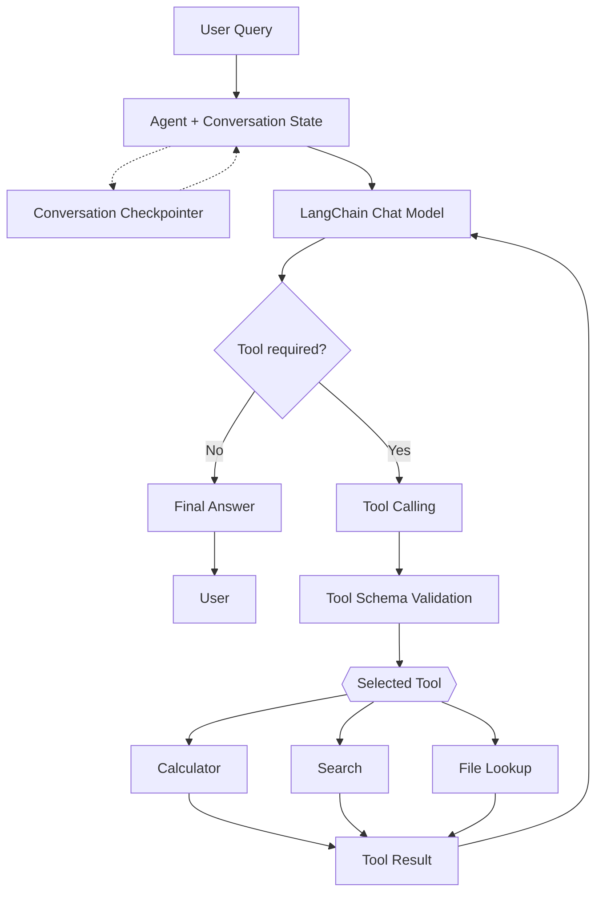

# langchain-agent-rebuild
Rebuild of [react-agent-from-scratch](https://github.com/sadrjahani/react-agent-from-scratch) with LangChain, for a fair side-by-side comparison.

## Status
Skeleton. See roadmap issues on GitHub.

## Quick start
```bash
uv sync
cp .env.example .env
ollama pull phi4-mini
uv run python -m langchain_agent.main
```

## Architecture (target)



## Comparison / Limitations
TODO (Phase 7). See `docs/comparison.md`.
